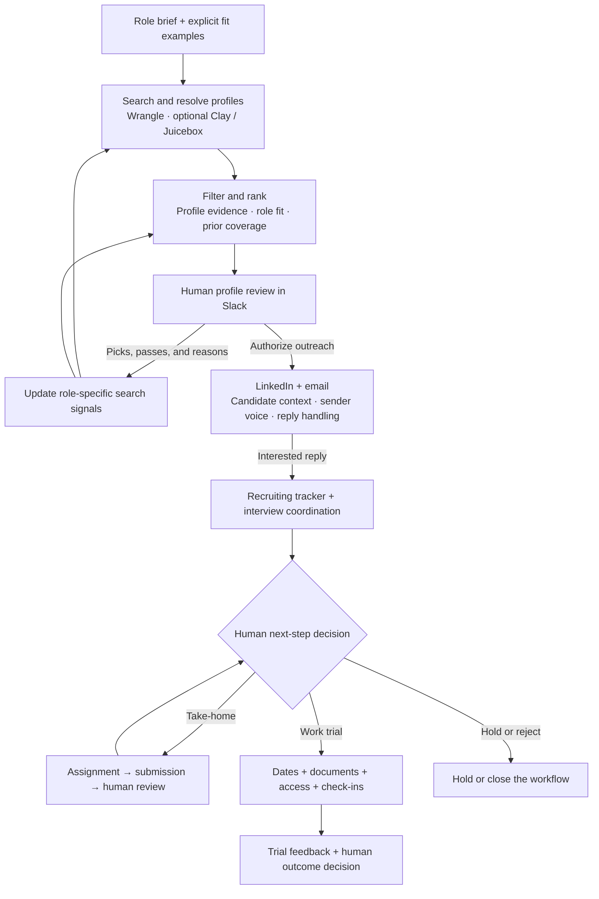
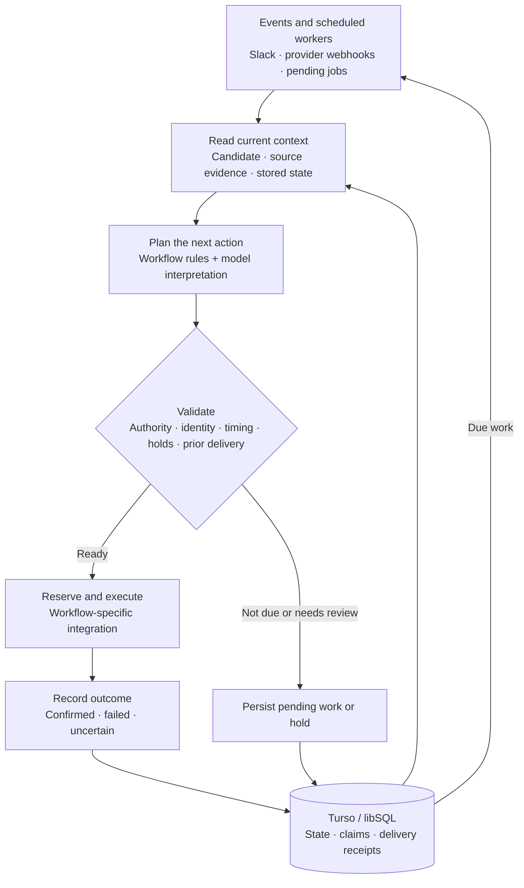
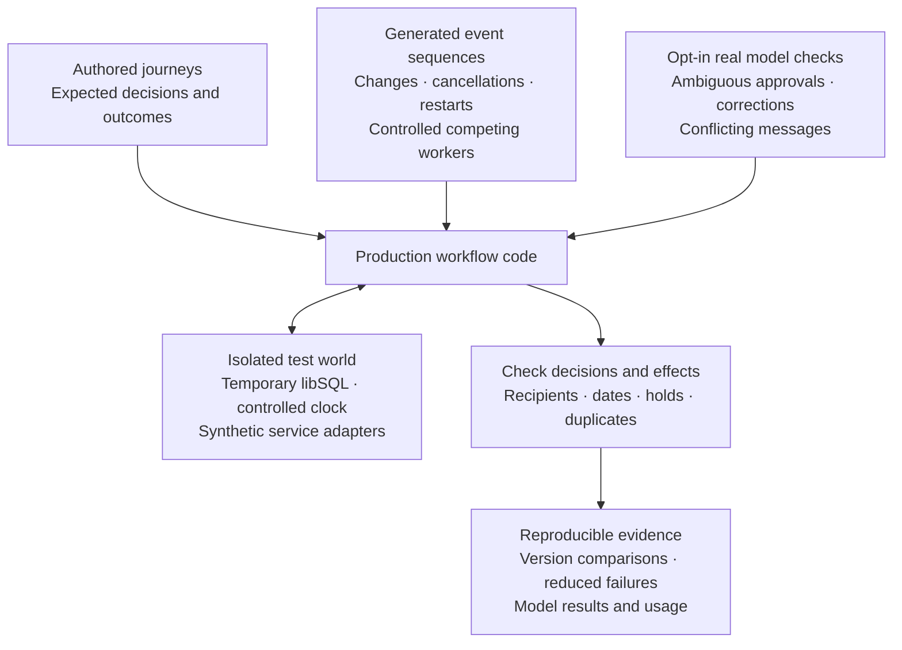

# Uncle Sam

**Recruiting automation that connects sourcing, feedback, outreach, and operations.**

[](https://github.com/mbosborn/uncle-sam/actions/workflows/tests.yml)


Uncle Sam turns role requirements and reviewer feedback into targeted sourcing strategies, using Wrangle to search for and enrich candidates. It ranks profiles against evidence of the work and runs custom LinkedIn and email outreach shaped by candidate context, the sender's voice, and the conversation so far. Once a candidate enters the recruiting process, it handles interview follow-ups, take-home coordination, work-trial scheduling, paperwork, and onboarding through Slack and connected services.

The model helps interpret context; explicit workflow rules and durable state decide what can run. Profile evidence informs ranking, human decisions authorize next steps, and delivery receipts determine what can safely run again. The details have to line up, from the agreed trial terms to the email and calendar invite.

[Workflow](#workflow) · [Sourcing](#feedback-driven-sourcing) · [Outreach](#conversation-aware-outreach) · [Learning](#learning-from-results) · [Architecture](#architecture) · [Development](#development)

## Workflow

Two loops connect the system: reviewer feedback shapes candidate discovery, while verified events and human decisions drive recruiting operations. The stages below represent supported paths; candidates advance according to the applicable workflow and authorization.



## Feedback-driven sourcing

**Uncle Sam builds the search; Wrangle runs it.** The planner combines the role brief, explicit fit examples, reviewer reasons, previous queries, and coverage history into targeted search prompts. It varies the angle across relevant work, adjacent backgrounds, and company leads, with instructions to avoid repeating recent searches. Each review gives the next search more context.

Wrangle's [MCP integration](https://wrangle.ai/developers) makes natural-language people search, LinkedIn profile resolution, email enrichment, and saved collections available through one connection. Results join a shared pool; shown and selected profiles can be saved back to Wrangle. Uncle Sam supplies the search strategy, selection rules, and feedback loop.

**Review history becomes structured search context.** The history pass reads profile lists with authorized reviewers' thread replies, reactions, and available Wrangle collection feedback. It preserves picks, explicit passes, people not selected from a reviewed batch, and the reasons given. Unreviewed lists contribute no preference signal; interview outcomes and compensation discussions stay separate from profile-selection feedback.

**Ranking uses evidence about the work.** Role-specific preferences capture relevant projects, teams, technical work, and career paths. Explicit calibration overrides conflicting inferred preferences. For roles configured to require it, a selected profile must include an exact supporting quote from its supplied description. Batch size is a ceiling. If the evidence is weak, Uncle Sam can return fewer people instead of filling the list just to hit a number. These checks establish support in the source text, not independent verification of a profile's claims.

These signals inform both search planning and ranking. The deployed learning extensions below also evaluate changes to that guidance and the allocation of future searches.

[Wrangle integration](service/lib/wrangle.mjs) · [Review extraction](service/lib/profile-reviews.mjs) · [History reconstruction](service/lib/taste-history.mjs) · [Calibration and limits](docs/CANDIDATE-DISCOVERY-AND-SOURCING.md)

## Conversation-aware outreach

Uncle Sam has a custom outreach pipeline built around the sender's message, candidate context, and conversation state. An approved profile enters a persistent queue. Unipile handles LinkedIn delivery through an existing connection, a request followed by acceptance, or enabled InMail; Wrangle and Clay can supply email enrichment.

- **A recognizable opening:** the sender's authored message preserves their voice and company facts, with the person's name and company or role filled from the profile. Connection notes, direct messages, and messages after acceptance each have their own wording.
- **Tailored emails and follow-ups:** the model receives the person's headline, role, company, prior experience, and the approved fact sheet. Writing instructions call for a concrete profile detail, a short conversational ask, and no invented familiarity or claims. Application checks reject unexpected links and restricted topics; authored fallbacks cover unusable drafts.
- **Replies that follow the conversation:** recent message history and the fact sheet inform a reply, close, or human handoff. The booking link comes after interest. Compensation, contracts, and questions outside the available facts go to a person.
- **Coordinated delivery:** a reply on either channel stops the silence-based follow-up path. Sending windows, daily limits, delivery claims, and takeover controls govern execution.

The deployed copy learner adds measured changes to the closing invitation while preserving the rest of the authored message. Its evidence and limits are described below.

[Outreach implementation](service/lib/outreach.mjs) · [Outreach tests](test/outreach.test.mjs)

## Learning from results

**Where to search, what work to value, and how to start the conversation each have their own learning loop.** These extensions run in the private deployment; their modules and operational records are outside this public snapshot.

**Search approaches earn their share.** Wrangle queries retain their strategy, mode, and configuration version; newly discovered profiles keep that attribution through review. [MABWiser](https://github.com/fidelity/mabwiser) uses Thompson sampling on explicit picks and passes to allocate future search slots. Each approach needs eight reviewed new profiles across at least three searches in the same mode before adaptation. Until then, approaches rotate evenly. Duplicate discoveries earn no new credit, and bounded exploration keeps alternatives in play.

**Reviewer reasons inform both search and ranking.** [GEPA](https://github.com/gepa-ai/gepa) proposes work-evidence guidance from explicit reviews and supporting profile text. Training, validation, and final testing use separate people. Adoption requires a five percentage point gain on both validation and held-out balanced agreement, no loss in pick recall or pass specificity, and preservation of role requirements. Accepted guidance feeds the Wrangle planner and ranker. Changed requirements invalidate old guidance; clearly worse subsequent results can trigger rollback.

**Outreach wording is measured against actual responses.** Acknowledged LinkedIn sends retain their exact text and version. Replies, classified interest, declines, feedback themes, and observed bookings stay separate. Comparisons use a 14-day window and matching sender, role, source, and delivery route; email-contacted recipients are excluded. At least 40 mature conversations are required before trying a permitted change to the closing invitation. Wilson intervals inform retention or rollback. Uncle Sam's implementation draws on [Pigeon's](https://github.com/tarinagarwal/Pigeon) per-template response measurement pattern.

Each change has a reason and a record. These learners treat silence as unknown and keep reply rate separate from technical fit. These observational comparisons require sufficient evidence; they do not by themselves prove better hires or cost savings.

## Recruiting operations

| Capability | Technical detail |
| --- | --- |
| Contextual candidate lookup | Reads Slack thread context and supported screenshots, extracts identity clues, then re-fetches the matching record. Namesakes and incomplete evidence require clarification. |
| Interview follow-through | Uses available Meet participation/end evidence or calendar timing. Existing feedback, decisions, withdrawals, and holds are checked before interviewer prompts. |
| Take-home coordination | Tracks invitation, submission, and human review separately. Reminder timing accounts for current status and stated completion plans. |
| Shared trial scheduling | Compares up to 32 trial orderings across eight candidates, using their time zones, interviewer calendars and buffers. The forecast and booking paths share the planner. Existing invitations stay fixed, and each candidate needs a complete verified schedule before booking. |
| First-check-in protection | Reads back the actual calendar occurrence, required guests, conflicts, time zone, and notice window before emailing a confirmed time. A planned slot alone is insufficient; routine optimization cannot silently move the first meeting. |
| Document validation | Checks every packet page, recipient, signing field, and candidate-specific term against versioned schemas. Hashes and field fingerprints bind validation receipts to the checked packet. Resends are validated again. |
| Access lifecycle | Optional Okta and Insightful integrations coordinate onboarding and offboarding, including readback of project/task assignments. |
| Payout onboarding | A restricted Stripe path collects payout details after a confirmed first check-in. Its client is limited to account and onboarding-link creation; it cannot send payments. |

**A schedule has to work across the whole trial.** Each calendar series contains the exact dates and times selected by the shared plan, including daylight-saving changes and later-day conflicts. Before creating invitations, Uncle Sam rechecks availability, candidate details and holds. Durable reservations coordinate workers; uncertain writes retain their provider IDs for review. The planner uses a bounded search with no additional service or solver dependency. [Scheduling design and tests](docs/JOINT-CHECKINS.md)

## Architecture

Node.js 22 and Vercel Functions host event handlers and scheduled workers. Turso/libSQL persists workflow state, pending actions, claims, and receipts. Integration modules connect external systems; the Claude client supplies interpretation, ranking, and structured proposals where needed. The private deployment also runs GEPA and MABWiser in a bounded Python worker; the Node workflow validates results against the current role and configuration before using them.



The diagram summarizes shared patterns; individual workflows apply their own checks and integrations.

- **Separate interpretation from execution.** Structured model proposals are checked by application code against source records and authorization rules before workflow actions run.
- **Revalidate at the action boundary.** Queued work can become stale. Trial invitations bind approval to the recipient and agreed rate, and cancellation checks the exact queue revision. Relevant identity, dates, status, holds, and delivery evidence are checked again before execution.
- **Persist execution state.** Semantic action keys, atomic claims, and delivery receipts help prevent duplicate work across repeated events and worker runs. Confirmed failures and uncertain sends follow different recovery paths; an unclear delivery result is held for reconciliation.
- **Keep operational states distinct.** An invitation is not attendance, an uploaded take-home is not a pass, and a queued email is not confirmed delivery. Those distinctions control downstream actions.

## Work-trial replay

**The tests check the decisions and the consequences.** Synthetic candidates enter through interview feedback, deep-dive feedback, recap decisions, fast-tracking and direct document requests. Those paths reach the real trial queues, document confirmation, account setup and calendar workers. Assertions check who receives each email, which terms it contains, when it can send, and whether the calendar matches the promise.



**Authored replay proves expected behavior across a complete journey.** The same scenarios run against two code revisions to expose regressions. Fewer actions alone do not count as an improvement; the expected recipients, terms, timing and calendar effects still have to match.

**Generated replay searches for combinations we did not think to write.** fast-check varies event sequences and the order in which competing workers reach simulated services. Failures are reduced to a reproducible sequence with a saved seed and scheduling order. Once corrected, that sequence joins the permanent regression tests. This helps protect against stale dates, duplicate delivery and work that resumes after a cancellation or hold.

**Fresh model evaluations test whether the instruction was understood.** A separate suite asks the configured model to interpret approvals, corrections, cancellations and conflicting messages using the production prompts. It checks the proposed decision as well as the resulting workflow, so a mistaken approval fails even if another guard catches it later. Repeated runs record the actual model, token usage and source version, with limits on requests and output tokens.

**Mutation testing checks whether those tests would notice a broken safeguard.** Stryker deliberately bypasses selected recipient, cancellation, compensation and calendar checks in temporary source copies. The relevant replay assertions must fail. It also forces each check to block valid work, so preventing every send cannot earn a pass. Crashes and timeouts do not count as caught safeguards.

Workflow effects remain isolated across these suites. Only the opt-in model broker can reach the configured model API; it receives synthetic conversations. Candidate services stay disconnected, reports stay local, and CI runs the offline checks without model credentials. Passing establishes behavior for the cases and schedules tested, not every possible event or instruction.

[Run the suites](docs/REPLAY.md) · [Authored scenarios](test/replay/scenarios.mjs) · [Generated exploration](test/replay/generated.mjs) · [Model decision cases](test/model-eval/scenarios.mjs) · [Mutation testing](docs/MUTATION-TESTING.md)

## Explore the implementation

| Area | Source and verification |
| --- | --- |
| Sourcing and calibration | [Ranking](service/lib/sourcing.mjs), [calibration](service/lib/sourcing-calibration.mjs), [tests](test/sourcing-calibration.test.mjs) |
| Event orchestration | [Vercel handlers](service/lib/vercel-handlers.mjs), [agent runner](service/lib/agent-runner.mjs), [workflow policy](service/lib/workflow-policy.mjs) |
| Scheduling | [Shared planner](service/lib/checkin-joint-plan.mjs), [booking design](docs/JOINT-CHECKINS.md), [joint scheduling tests](test/joint-checkins.test.mjs), [first-check-in protection](docs/FIRST-CHECKIN-RELIABILITY.md) |
| Document delivery | [Validation design](docs/DOCUMENT-CHECKER.md), [send-boundary tests](test/document-send-boundary.test.mjs) |
| Candidate lookup | [Thread identity design](docs/THREAD-IDENTITY.md), [tests](test/thread-identity.test.mjs) |

## Development

Use Node.js 22:

```sh
npm ci
npm test
npm run test:replay
npm run test:explore
npm run test:mutate
```

Configuration starts with [.env.secrets.example.json](.env.secrets.example.json) and [DEPLOY-VERCEL.md](DEPLOY-VERCEL.md). Supply your own accounts, workspace schema, templates, and credentials. Keep automatic activity off while configuring and testing integrations.

GitHub Actions runs the existing tests, retained regressions, authored replay, a seeded generated exploration and the safeguard mutation campaign on pushes to `main` and pull requests. Fresh model evaluations run separately when explicitly requested. Tests use simulated providers; passing checks do not establish live integration readiness.

## Repository scope

This repository is a sanitized source snapshot. Source links point to the implementations included here. The GEPA guidance optimizer, MABWiser search allocator, and LinkedIn copy learner described above remain in the private deployment. Availability depends on the integrations and permissions configured for a deployment.

Example identities, contact details, workspace identifiers, and organization branding are synthetic. Internal operating history, credentials, production deployment metadata, and private candidate documents are excluded. Document templates must be configured and validated against your own approved originals before delivery is enabled.

Replay fixtures and reports contain invented data only. Real candidate records, private Notion content and take-home submissions must stay outside this repository; replay reports are local and are not uploaded by CI.
