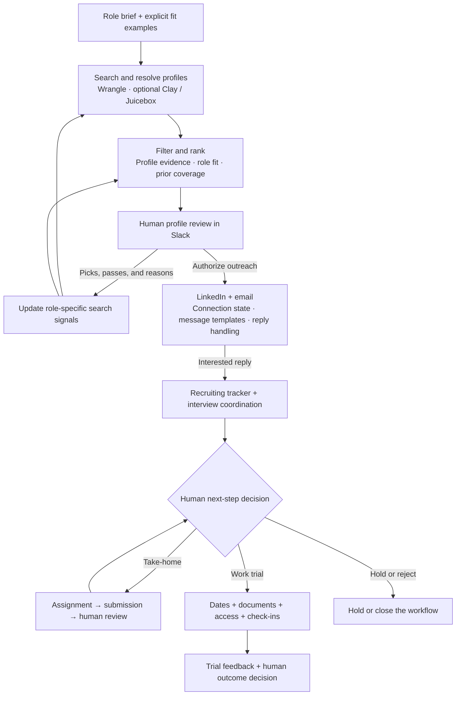
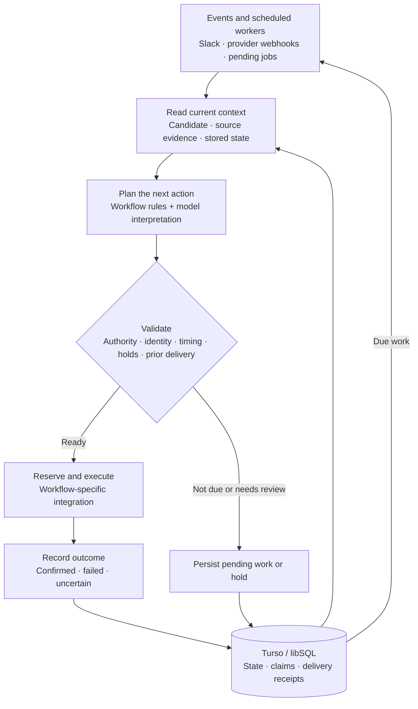
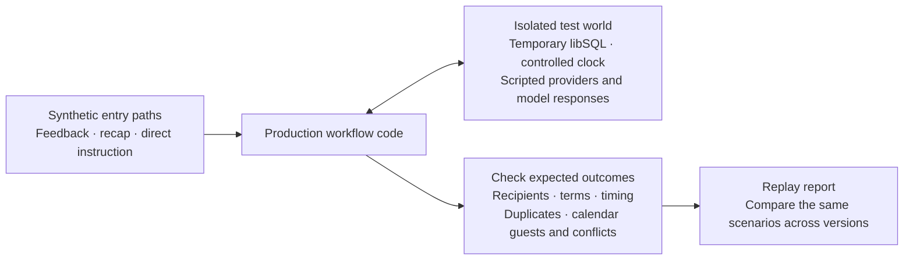

# Uncle Sam

**Recruiting automation that connects sourcing, feedback, outreach, and operations.**

[](https://github.com/mbosborn/uncle-sam/actions/workflows/tests.yml)


Uncle Sam turns role requirements and reviewer feedback into targeted sourcing strategies, using Wrangle to search for and enrich candidates. It ranks profiles against evidence of the work and coordinates LinkedIn and email outreach. Once a candidate enters the recruiting process, it handles interview follow-ups, take-home coordination, work-trial scheduling, paperwork, and onboarding through Slack and connected services.

Its core design combines model-based interpretation with explicit workflow rules and durable state. Profile evidence informs ranking, human decisions authorize next steps, and delivery receipts determine what can safely run again.

[Workflow](#workflow) · [Sourcing](#feedback-driven-sourcing) · [Outreach](#conversation-aware-outreach) · [Architecture](#architecture) · [Development](#development)

## Workflow

Two loops connect the system: reviewer feedback shapes candidate discovery, while verified events and human decisions drive recruiting operations. The stages below represent supported paths; candidates advance according to the applicable workflow and authorization.



## Feedback-driven sourcing

**Wrangle brings natural-language people search directly into the workflow.** Its [MCP integration](https://wrangle.ai/developers) lets Uncle Sam run detailed candidate searches, resolve LinkedIn profiles, enrich emails, and save results to collections through one connection. Uncle Sam supplies the role-specific queries, reviewer context, and selection rules. Results join a shared pool; shown and selected profiles can be saved back to Wrangle, while prior coverage helps avoid repeatedly surfacing the same people and companies.

**Review history becomes structured search context.** The history pass reads profile lists with authorized reviewers' thread replies, reactions, and available Wrangle collection feedback. It preserves picks, explicit passes, people not selected from a reviewed batch, and the reasons given. Unreviewed lists contribute no preference signal; interview outcomes and compensation discussions stay separate from profile-selection feedback.

**Ranking uses evidence about the work.** Role-specific preferences capture relevant projects, teams, technical work, and career paths. Explicit calibration overrides conflicting inferred preferences. For roles configured to require it, a selected profile must include an exact supporting quote from its supplied description. Batch size is a ceiling, so weak evidence can produce fewer results instead of quota padding. These checks establish support in the source text, not independent verification of a profile's claims.

The resulting signals influence both search planning and ranking, including suggestions for adjacent companies and less-covered sources. This is persisted feedback used as model context, rather than model-weight training.

[Wrangle integration](service/lib/wrangle.mjs) · [Review extraction](service/lib/profile-reviews.mjs) · [History reconstruction](service/lib/taste-history.mjs) · [Calibration and limits](docs/CANDIDATE-DISCOVERY-AND-SOURCING.md)

## Conversation-aware outreach

An approved profile enters a persistent outreach queue. Unipile handles LinkedIn delivery according to connection state: an existing connection, a connection request followed by acceptance, or enabled InMail. Wrangle and Clay can supply email enrichment.

Writing and delivery depend on the conversation stage:

- **Opening messages:** fixed LinkedIn templates personalized with the person's name and background, preserving the intended voice.
- **Emails and follow-ups:** model-written drafts use profile context and a fact sheet, with length, link, and content checks plus template fallbacks.
- **Replies:** the model uses conversation history and the fact sheet to propose a reply, close, or human handoff. Unsupported questions, including compensation and contracts, are directed to a person.
- **Progression:** interest can trigger a booking link and tracker entry; declines close the conversation, and replies stop the no-response follow-up path. Sending windows, daily limits, prior-delivery checks, and takeover controls govern execution.

[Outreach implementation](service/lib/outreach.mjs) · [Outreach tests](test/outreach.test.mjs)

## Recruiting operations

| Capability | Technical detail |
| --- | --- |
| Contextual candidate lookup | Reads Slack thread context and supported screenshots, extracts identity clues, then re-fetches the matching record. Namesakes and incomplete evidence require clarification. |
| Interview follow-through | Uses available Meet participation/end evidence or calendar timing. Existing feedback, decisions, withdrawals, and holds are checked before interviewer prompts. |
| Take-home coordination | Tracks invitation, submission, and human review separately. Reminder timing accounts for current status and stated completion plans. |
| Trial capacity forecasting | Projects upcoming check-ins across team calendars and candidate time zones to identify conflicts before trial starts, without creating meetings during planning. |
| First-check-in protection | Verifies the actual occurrence, guests, conflicts, time zone, and notice window before sending a confirmation. Routine optimization cannot silently move the first meeting. |
| Document validation | Checks every packet page, recipient, signing field, and candidate-specific term against versioned schemas. Hashes and field fingerprints bind validation receipts to the checked packet. Resends are validated again. |
| Access lifecycle | Optional Okta and Insightful integrations coordinate onboarding and offboarding, including readback of project/task assignments. |
| Payout onboarding | A restricted Stripe path collects payout details after a confirmed first check-in. Its client is limited to account and onboarding-link creation; it cannot send payments. |

## Architecture

Node.js 22 and Vercel Functions host event handlers and scheduled workers. Turso/libSQL persists workflow state, pending actions, claims, and receipts. Integration modules connect external systems; the Claude client supplies interpretation, ranking, and structured proposals where needed.



The diagram summarizes shared patterns; individual workflows apply their own checks and integrations.

- **Separate interpretation from execution.** Structured model proposals are checked by application code against source records and authorization rules before workflow actions run.
- **Revalidate at the action boundary.** Queued work can become stale. Relevant identity, dates, status, holds, and delivery evidence are checked again before execution.
- **Persist execution state.** Semantic action keys, atomic claims, and delivery receipts help prevent duplicate work across repeated events and worker runs. Confirmed failures and uncertain sends follow different recovery paths; an unclear delivery result is held for reconciliation.
- **Keep operational states distinct.** An invitation is not attendance, an uploaded take-home is not a pass, and a queued email is not confirmed delivery. Those distinctions control downstream actions.

## Work-trial replay

The replay suite follows synthetic candidates through interview feedback, deep-dive feedback, recap decisions, fast-tracking and direct document requests. Those paths converge on the real trial queues, document confirmation, account setup and calendar workers. It checks who receives each email, which terms it contains, when it can send, and whether the calendar matches the promise.



Scenarios include overlapping funnels, changed recipients and terms, cancellations, outages, uncertain delivery, restarts, competing trials and first-meeting revisions. The runner blocks outbound network calls and uses invented data. Version comparison reports improvements and regressions against the same expectations; passing establishes behavior for the scenarios covered.

[Run the suite and compare versions](docs/REPLAY.md) · [Scenario definitions](test/replay/scenarios.mjs)

## Explore the implementation

| Area | Source and verification |
| --- | --- |
| Sourcing and calibration | [Ranking](service/lib/sourcing.mjs), [calibration](service/lib/sourcing-calibration.mjs), [tests](test/sourcing-calibration.test.mjs) |
| Event orchestration | [Vercel handlers](service/lib/vercel-handlers.mjs), [agent runner](service/lib/agent-runner.mjs), [workflow policy](service/lib/workflow-policy.mjs) |
| Scheduling | [Capacity planner](service/lib/checkin-plan.mjs), [first-check-in design](docs/FIRST-CHECKIN-RELIABILITY.md), [tests](test/first-checkin.test.mjs) |
| Document delivery | [Validation design](docs/DOCUMENT-CHECKER.md), [send-boundary tests](test/document-send-boundary.test.mjs) |
| Candidate lookup | [Thread identity design](docs/THREAD-IDENTITY.md), [tests](test/thread-identity.test.mjs) |

## Development

Use Node.js 22:

```sh
npm ci
npm test
npm run test:replay
```

Configuration starts with [.env.secrets.example.json](.env.secrets.example.json) and [DEPLOY-VERCEL.md](DEPLOY-VERCEL.md). Supply your own accounts, workspace schema, templates, and credentials. Keep automatic activity off while configuring and testing integrations.

GitHub Actions runs the existing tests and the work-trial replay suite on pushes to `main` and pull requests. Tests use simulated providers; passing checks do not establish live integration readiness.

## Repository scope

This repository is a sanitized source snapshot. The features above describe included implementations; availability depends on the integrations and permissions configured for a deployment.

Example identities, contact details, workspace identifiers, and organization branding are synthetic. Internal operating history, credentials, production deployment metadata, and private candidate documents are excluded. Document templates must be configured and validated against your own approved originals before delivery is enabled.

Replay fixtures and reports contain invented data only. Real candidate records, private Notion content and take-home submissions must stay outside this repository; replay reports are local and are not uploaded by CI.
