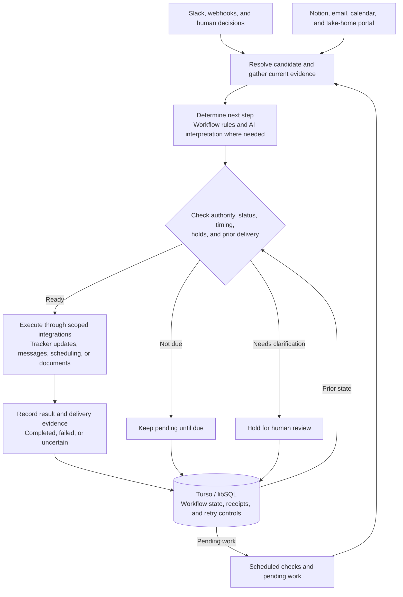

# Uncle Sam

**Recruiting Coordinator**

[](https://github.com/mbosborn/uncle-sam/actions/workflows/tests.yml)


Uncle Sam coordinates recruiting workflows across Slack, a recruiting tracker, email, and calendar. It supports interview follow-ups, take-home assignments, work-trial scheduling, document checks, and human decisions.

## What it coordinates

| Workflow | What Uncle Sam handles |
| --- | --- |
| Interview follow-through | Collect feedback, interpret explicit next steps, and keep tracker records current |
| Take-home assignments | Prepare invitations, track submissions, and route work for human review |
| Work trials | Coordinate dates, check-ins, onboarding, and document validation |
| Delivery reliability | Preserve action receipts, recheck current evidence, and hold uncertain sends |

## Architecture

Uncle Sam combines event handlers, scheduled checks, and workflow-specific rules. Each workflow connects an incoming signal to the relevant candidate and current records, checks whether an action is allowed and due, and records the result. AI helps interpret messages and propose structured actions; application code validates those proposals and controls execution.

The diagram shows the shared flow across workflows. Individual workflows use the integrations and checks relevant to their task.



- **Runtime and integrations.** JavaScript on Node.js 22 runs in Vercel Functions for webhooks and scheduled work. Integration modules connect Slack, Notion, Gmail, Google Calendar, the take-home portal, and optional services such as DocuSign.
- **Candidate and event context.** Actions are tied to the relevant candidate and interview, assignment, or trial. Workflows check current source records before acting. A booked interview, an uploaded submission, a human review, and an approved next step are separate pieces of evidence.
- **Decision checks.** Model proposals are validated against stored events, candidate records, and authorization rules. Workflow-specific checks enforce holds, pause controls, required details, and recipient matching. Missing or conflicting evidence can leave work pending or require human review.
- **Scheduling.** Follow-ups use the relevant event time, prior delivery, and current workflow state. Depending on the workflow, business-day rules, sending hours, rescheduling, replies, and a candidate's stated completion date can change when an action becomes due. Scheduled work is rechecked before execution.
- **State and recovery.** Turso/libSQL stores pending actions, delivery receipts, and retry controls. Action keys and claims help prevent duplicate execution. Confirmed delivery, retryable failures, and uncertain outcomes are tracked separately so an unclear send result is not blindly retried.

Human decisions remain part of the workflow. The coordinator uses those decisions and the latest evidence to determine what can happen next; recorded outcomes then inform subsequent checks.

## Development

```sh
npm ci
npm test
```

Start with `.env.secrets.example.json` and `DEPLOY-VERCEL.md` for configuration. Supply your own accounts, templates, workspace schema, and credentials. Keep automatic activity off while configuring and testing integrations.

## Public source

This repository contains a sanitized source snapshot. Example identities, contact details, workspace identifiers, and organization branding are synthetic. Internal operating history, local credentials, production deployment metadata, and private candidate documents are excluded. Configure and validate document templates against your own approved originals before enabling document delivery.

Local tests use simulated providers; passing tests do not establish that your live integrations are configured.

GitHub Actions runs the test suite for each public source update and pull request. Its badge reflects those checks. Public updates contain reviewed source changes; private recruiting activity stays in the private operational systems.
