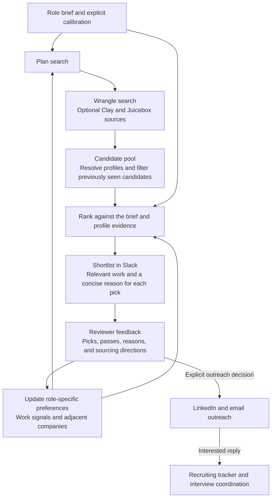
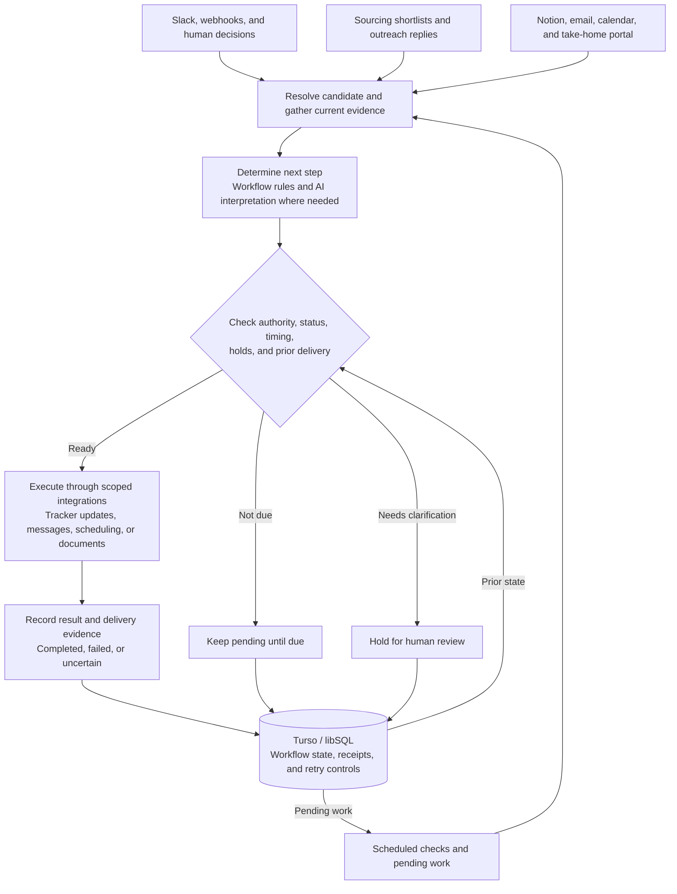

# Uncle Sam

**Recruiting Coordinator**

[](https://github.com/mbosborn/uncle-sam/actions/workflows/tests.yml)


Uncle Sam connects candidate sourcing, recruiter feedback, outreach, and recruiting operations. It uses Wrangle and other sourcing providers to find profiles, carries reviewer feedback into subsequent searches, coordinates LinkedIn and email conversations, and follows candidates through interviews, take-homes, and work trials.

The features below describe the implementation in this source snapshot. External integrations require their own configuration, permissions, and live validation.

## What it coordinates

| Workflow | What Uncle Sam handles |
| --- | --- |
| Sourcing and calibration | Search through Wrangle, resolve LinkedIn profiles, and rank candidates using role-specific evidence and reviewer feedback |
| Outreach and replies | Queue selected profiles, coordinate LinkedIn and email, and route interested replies into the recruiting tracker |
| Interview follow-through | Collect feedback, interpret explicit next steps, and keep tracker records current |
| Take-home assignments | Prepare invitations, track submissions, and route work for human review |
| Work trials | Coordinate dates, check-ins, onboarding, and document validation |
| Delivery reliability | Preserve action receipts, recheck current evidence, and hold uncertain sends |

## Sourcing and feedback

Wrangle connects through OAuth and MCP for people search, LinkedIn profile resolution, email enrichment, and collections. Search results join a shared candidate pool; profiles already shown, reviewed, or present in the recruiting tracker are filtered before a new shortlist is prepared. Selected and shown profiles can also be saved back to Wrangle.



- **Feedback with context.** The history pass reads profile lists alongside authorized reviewers' replies and reactions, plus available Wrangle collection feedback. It distinguishes an explicit pass from someone not selected in a reviewed batch, retains reasons, and leaves unreviewed lists out of preference learning. Interview results and compensation discussions are kept separate from profile-selection feedback.
- **Signals beyond job titles.** Profile details help identify relevant teams, projects, technical work, and career paths. These signals and explicit sourcing directions inform subsequent searches, including adjacent companies and less-covered sources. Preferences are scoped to the role; newer explicit calibration takes precedence over inferred preferences.
- **Evidence-based shortlists.** Ranking preserves work descriptions and can require an exact supporting quote from a profile. Company reputation alone does not establish fit. The requested batch size is a maximum: the system can return fewer candidates rather than fill a quota. These checks validate the supplied evidence, not the truth of a candidate's claims.

See [profile review extraction](service/lib/profile-reviews.mjs), [history reconstruction](service/lib/taste-history.mjs), and [sourcing calibration](docs/CANDIDATE-DISCOVERY-AND-SOURCING.md).

## LinkedIn and email outreach

Selected profiles enter a separate outreach queue. LinkedIn delivery uses Unipile and accounts for whether the person is already connected, needs a connection request, or can receive an enabled InMail. Email enrichment can use Wrangle, with Clay as a fallback.

Writing follows the stage of the conversation. LinkedIn connection notes and opening messages use configured templates personalized with the person's name and background. Model-written emails and follow-ups use profile context and a fact sheet, with length, link, and content checks. The model is instructed to answer replies from the fact sheet and hand off questions it cannot support, including compensation and contract questions.

An interested reply can trigger a booking link and a tracker entry. Declines close the conversation; replies stop the no-response follow-up path. Sending windows, daily limits, duplicate checks, and human takeover controls govern delivery. The implementation is in [outreach.mjs](service/lib/outreach.mjs).

## Other workflow details

| Feature | How it works |
| --- | --- |
| Contextual candidate lookup | Resolves questions from Slack thread context and supported screenshots, then re-reads the matching record. Ambiguous names produce clarification rather than an assumed match. |
| Interview-aware follow-ups | Uses available Meet end evidence or calendar timing, then checks for existing feedback, decisions, withdrawals, and holds before prompting an interviewer. |
| Trial capacity planning | Looks ahead across upcoming trials and team calendars to flag check-in conflicts before a trial starts. Planning itself does not create meetings. |
| First-check-in confirmation | Verifies the actual invitation, guests, time zones, conflicts, and notice window before promising a time. The first occurrence is protected from routine automatic rescheduling. |
| Document validation | Checks every packet page, recipient, signing field, and candidate-specific term against expected schemas before sending or resending. Validation receipts preserve what was checked. |
| Onboarding and offboarding | Optional Okta and Insightful integrations coordinate access and trial setup, including readback of project/task assignments and deactivation during offboarding. |
| Payout setup | A separate restricted Stripe onboarding path collects payout details after a confirmed first check-in. This path cannot send payments. |

## Architecture

Uncle Sam combines event handlers, scheduled checks, and workflow-specific rules. Each workflow connects an incoming signal to the relevant candidate and current records, checks whether an action is allowed and due, and records the result. AI helps interpret messages and propose structured actions; application code validates those proposals and controls execution.

The diagram shows the shared flow across workflows. Individual workflows use the integrations and checks relevant to their task.



- **Runtime and integrations.** JavaScript on Node.js 22 runs in Vercel Functions for webhooks and scheduled work. Wrangle and optional sourcing providers supply profiles; Unipile and Gmail handle outreach. Slack, Notion, Google Calendar, the take-home portal, and optional document and onboarding services support the recruiting workflows.
- **Candidate and event context.** Actions are tied to the relevant candidate and interview, assignment, or trial. Workflows check current source records before acting. A booked interview, an uploaded submission, a human review, and an approved next step are separate pieces of evidence.
- **Decision checks.** Model proposals are validated against stored events, candidate records, and authorization rules. Workflow-specific checks enforce holds, pause controls, required details, and recipient matching. Missing or conflicting evidence can leave work pending or require human review.
- **Scheduling.** Follow-ups use the relevant event time, prior delivery, and current workflow state. Depending on the workflow, business-day rules, sending hours, rescheduling, replies, and a candidate's stated completion date can change when an action becomes due. Scheduled work is rechecked before execution.
- **State and recovery.** Turso/libSQL stores pending actions, delivery receipts, and retry controls. Action keys and claims help prevent duplicate execution. Confirmed delivery, retryable failures, and uncertain outcomes are tracked separately so an unclear send result is not blindly retried.

Human decisions remain part of the workflow. The coordinator uses those decisions and the latest evidence to determine what can happen next; recorded outcomes then inform subsequent checks.

## Development

```sh
npm ci
npm test
```

Start with `.env.secrets.example.json` and `DEPLOY-VERCEL.md` for configuration. Supply your own accounts, templates, workspace schema, and credentials. Keep automatic activity off while configuring and testing integrations.

## Public source

This repository contains a sanitized source snapshot. Example identities, contact details, workspace identifiers, and organization branding are synthetic. Internal operating history, local credentials, production deployment metadata, and private candidate documents are excluded. Configure and validate document templates against your own approved originals before enabling document delivery.

Local tests use simulated providers; passing tests do not establish that your live integrations are configured.

GitHub Actions runs the test suite for each public source update and pull request. Its badge reflects those checks. Public updates contain reviewed source changes; private recruiting activity stays in the private operational systems.
