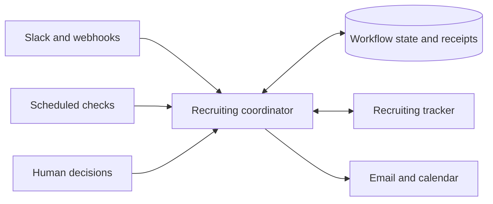

# Uncle Sam

**Recruiting Coordinator**

[](https://github.com/mbosborn/uncle-sam/actions/workflows/tests.yml)


Uncle Sam coordinates recruiting workflows across Slack, a recruiting tracker, email, and calendar. It supports interview follow-ups, take-home assignments, work-trial scheduling, document checks, and human decisions.

## What it coordinates

| Workflow | What Uncle Sam handles |
| --- | --- |
| Interview follow-through | Collect feedback, interpret explicit next steps, and keep tracker records current |
| Take-home assignments | Prepare invitations, track submissions, and route work for human review |
| Work trials | Coordinate dates, check-ins, onboarding, and document validation |
| Delivery reliability | Preserve action receipts, recheck current evidence, and hold uncertain sends |

## Architecture



- JavaScript on Node.js 22, with Vercel Functions for webhooks and scheduled work.
- Turso/libSQL stores workflow state, delivery receipts, and retry controls.
- Integration modules connect Slack, Notion, Gmail, Google Calendar, and optional services.
- Automated decisions are constrained by authorization, current evidence, pause controls, and duplicate-send protection.

## Development

```sh
npm ci
npm test
```

Start with `.env.secrets.example.json` and `DEPLOY-VERCEL.md` for configuration. Supply your own accounts, templates, workspace schema, and credentials. Keep automatic activity off while configuring and testing integrations.

## Public source

This repository contains a sanitized source snapshot. Example identities, contact details, workspace identifiers, and organization branding are synthetic. Internal operating history, local credentials, production deployment metadata, and private candidate documents are excluded. Configure and validate document templates against your own approved originals before enabling document delivery.

Local tests use simulated providers; passing tests do not establish that your live integrations are configured.

GitHub Actions runs the test suite for each public source update and pull request. Its badge reflects those checks. Public updates contain reviewed source changes; private recruiting activity stays in the private operational systems.
